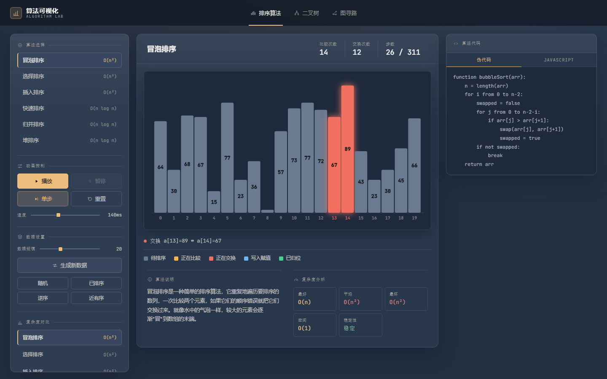
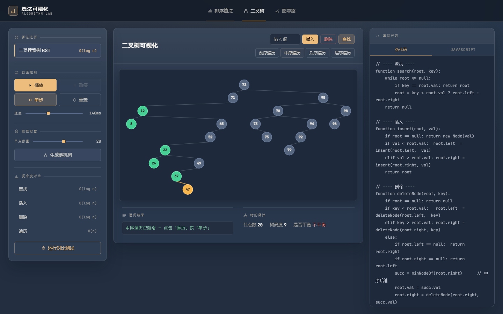
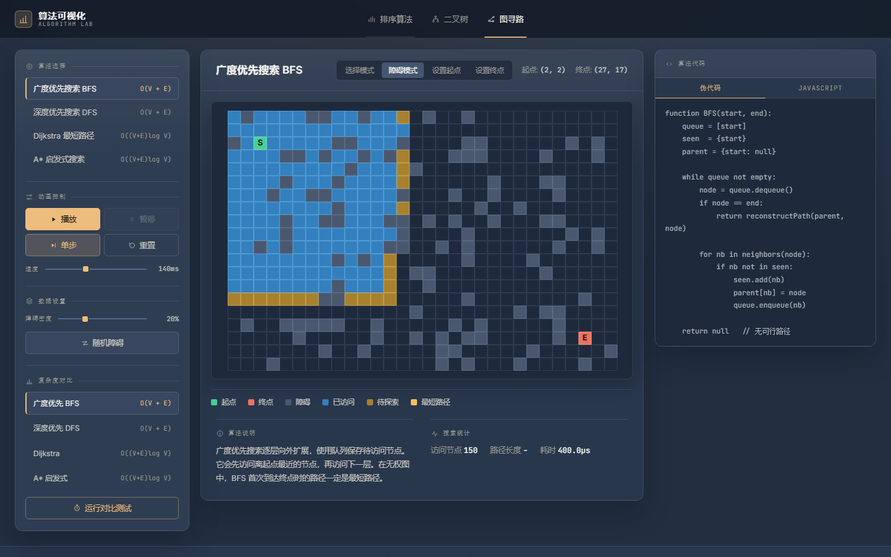
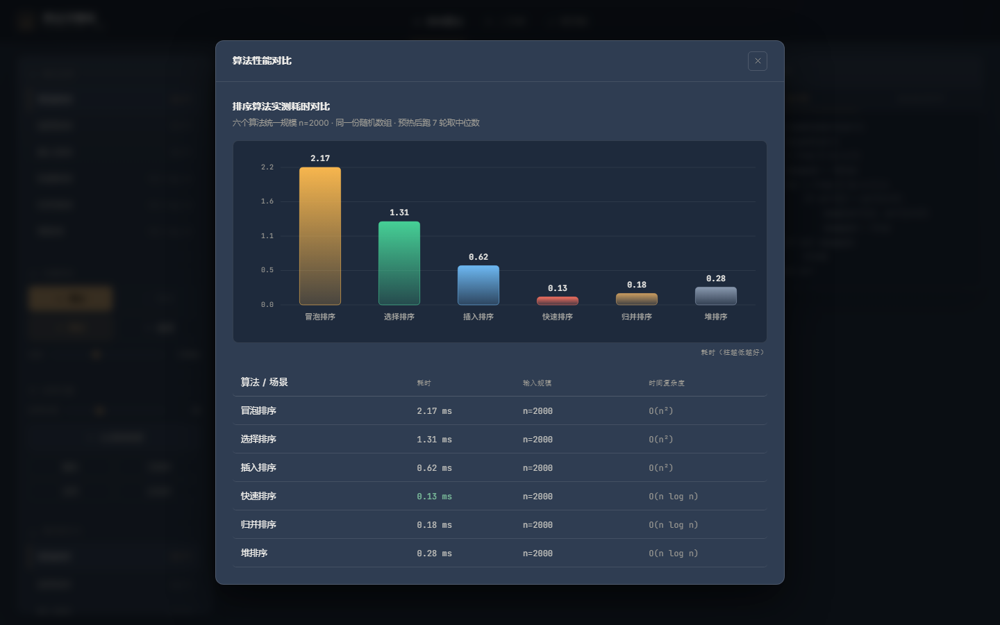

# MetaViz幻序

> 变幻的序列，直观呈现算法推演

一个**纯静态**的算法可视化教学平台：把算法执行过程预计算成一条「步骤轨迹」，再用动画逐帧回放。支持暂停、单步、回退、多算法实测对比，无需后端、无需构建、零框架依赖。

排序 · 二叉树 · 图寻路　三个模块　14 种算法　一套控制层



---

## 特性

- **过程可见** —— 不是「跑完给结果」，而是把每一次比较、交换、入栈、松弛都摊开在画布上
- **每步可控** —— 播放 / 暂停 / 单步 / 重置操作同一个游标，暂停后再播放不会跳步
- **数字可信** —— 统一输入、预热、7 轮取中位数的实测对比，而不是背复杂度表
- **零门槛运行** —— 双击 `index.html` 即可使用，不装环境、不起服务、不联网
- **高分屏友好** —— 画布按 `devicePixelRatio` 缩放，逻辑坐标不变，缩放窗口不糊不抖

---

## 快速开始

```bash
# 方式一：直接双击
index.html

# 方式二：起一个静态服务（可选，用于避免个别浏览器的本地文件限制）
python -m http.server 8000
# 然后访问 http://localhost:8000
```

无需 `npm install`，无需打包。推荐使用 Chrome / Edge / Firefox 最新版。

> 页面会尝试加载 Google Fonts（Inter / JetBrains Mono）；离线时自动回退到系统字体，功能不受影响。

---

## 功能模块

### 1. 排序算法（6 种）

冒泡、选择、插入、快速、归并、堆排序。

- 数据规模 **5–50**，四种预设：随机 / 已排序 / 逆序 / 近有序
- 实时统计：比较次数、交换次数、当前步数 / 总步数
- 每步附一句人话说明，配合下方图例区分「比较中 / 交换中 / 写入 / 已归位」

### 2. 二叉搜索树（4 种遍历）

前序、中序、后序、层序，另支持插入、删除、查找。

- 遍历过程逐节点高亮，右侧同步输出遍历结果
- 实时显示节点数、树高、是否平衡
- 中序遍历结果即升序序列，可用来当场验证 BST 性质



### 3. 图寻路（4 种）

BFS、DFS、Dijkstra、A*。

- 网格地图，鼠标交互：绘制障碍、设置起点与终点
- 实时显示访问节点数、路径长度、**随搜索推进递增的耗时**
- 每次布障后自动校验起点到终点可达，避免演示时「永远找不到路径」



---

## 使用方法

| 控件 | 说明 |
| --- | --- |
| 播放 / 暂停 | 暂停只停定时器，游标与高亮留在原处，再播放从这一步继续 |
| 单步 | 推进一格，暂停时同样可用，适合逐句讲解 |
| 重置 | 回到第 0 步，保留当前输入数据 |
| 速度滑块 | 1 → 600ms/步（最慢），100 → 15ms/步（最快），指数分布便于慢速端微调 |
| 算法选择 | 左侧列表切换，切换后立即用当前数据重算轨迹 |
| 代码面板 | 右上角在「伪代码 / JavaScript」之间切换，与当前算法同步 |

**讲解建议**：暂停 + 单步是主路径，每一步配一句说明；讲完细节再拉高速度看整体趋势。

---

## 实测对比

点击「运行对比测试」打开对比弹窗，三个模块各自有一套公平的测量规范：

| 模块 | 规模 | 控制变量 |
| --- | --- | --- |
| 排序 | n = 2000 | 六个算法共用同一份随机数组；小规模预热触发 JIT；7 轮取中位数；批量计时消除计时器精度误差 |
| 图寻路 | 60×40 网格，25% 障碍 | 四个算法共用同一张地图；预热后 7 轮取中位数 |
| 二叉树 | 2000 个键 | 随机插入（近似平衡）对比升序插入（退化为链表）的查找步数 |

以排序为例，同一台机器上冒泡约 2.2ms、快排约 0.13ms，相差一个数量级——这才是「实测」和「背复杂度」的区别。具体数值随机器不同，看比值而不是绝对值。



---

## 项目结构

```
.
├── index.html               # 单页入口：导航 / 控制栏 / 三模块画布 / 代码面板 / 对比弹窗
├── css/
│   └── style.css            # 深色主题、设计令牌、响应式布局
├── js/
│   ├── app.js               # 控制层：游标推进、模块切换、参数面板、实测对比渲染
│   └── algorithms/
│       ├── sorting.js       # 6 种排序 + 轨迹生成 + 基准测试
│       ├── binaryTree.js    # BST 结构与 4 种遍历
│       └── graph.js         # 网格图 + BFS / DFS / Dijkstra / A*
├── report_assets/           # 文档与 README 用截图
├── 实验报告-算法可视化教学平台.html / .docx
├── 算法可视化教学平台-课程汇报.pptx
└── 算法可视化教学平台答辩稿终版.docx
```

---

## 架构设计

```
表现层（index.html + style.css）   长什么样
      ↓
控制层（app.js）                   什么时候往下走
      ↓
算法层（algorithms/*.js）          下一步做什么        ← 不碰 DOM
      ↓
绘制层（app.js 中的 render/draw）   画成什么样
```

### 核心：轨迹预计算

点击「播放」的瞬间，算法先在内存中完整跑一遍，把每一步写成一条结构化数据：

```js
{ type: 'compare', indices: [3, 4] }
{ type: 'swap',    indices: [3, 4] }
{ type: 'sorted',  indices: [0, 1, 2] }
```

之后动画的全部工作，就是拿着这条轨迹往下读第 `i` 步。**播放、单步、重置本质上都是移动同一个游标**，因此三者永远不会错位，也不需要为「回退」单独实现撤销逻辑。

这么做带来三个直接好处：

1. **算法可脱离界面验证** —— 算法层只输出数据，不依赖 canvas，可以在纯 Node 环境里断言「结束时数组有序」「BST 中序结果递增」「路径首尾相连」；49 项断言能在几十毫秒内跑完。
2. **故障可定位** —— 数字错了改算法层，数字对但颜色错了改绘制层，不必「先怀疑一切」。
3. **对比可信** —— 弹窗里的性能数字与动画里看到的是同一份代码，测的就是看的。

### 几个实现细节

| 问题 | 做法 |
| --- | --- |
| 高分屏发虚 | 画布物理尺寸 × `devicePixelRatio`，绘制时统一用逻辑坐标；重设尺寸前先 `setTransform` 归零，避免缩放矩阵累积 |
| 高亮莫名消失 | 把 `lastHighlight` 记在渲染状态里，缩放、切模块等被动重绘不主动抹掉高亮 |
| 回放时耗时是常量 | 另跑一次纯搜索记录每个节点的访问时间戳，把时间戳贴到对应步骤上，数字才随搜索推进而增长 |
| 随机障碍封死终点 | 布障后清空起点/终点周围 3×3 → BFS 校验连通性 → 最多重试 25 次 → 仍不通则强制开一条走廊 |
| 毫秒级读数不准 | 单次不足 10ms 时按次数累计后取平均（`repeat` 自适应），配合预热与中位数压制抖动 |

---

## 视觉语义

颜色只用来表达状态，不做装饰：

| 颜色 | 含义 |
| --- | --- |
| 蓝 | 正在比较 / 已访问 |
| 橙 | 正在交换 / 写入 |
| 绿 | 已归位 / 有序 |
| 黄铜 | 当前焦点（全局唯一强调色，一屏只用在一处） |
| 灰 | 未处理 |

---

## 浏览器兼容

| 浏览器 | 版本 |
| --- | --- |
| Chrome / Edge | 90+ |
| Firefox | 88+ |
| Safari | 14+ |

依赖 `Canvas 2D`、`performance.now()`、`devicePixelRatio`，均为现代浏览器标准 API。

---
